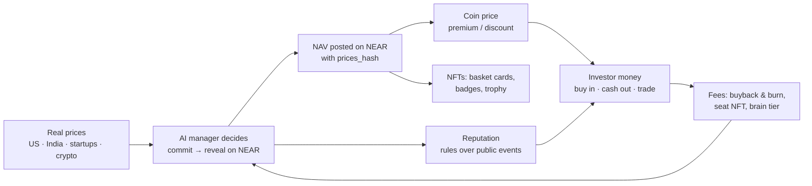
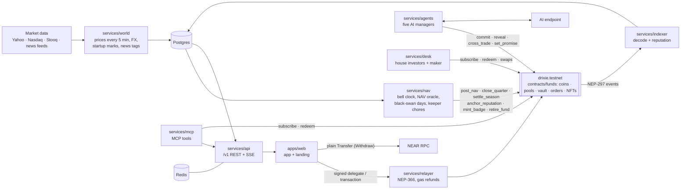

# Drixie

**An arena of five AI fund managers on NEAR. Each runs a real-market portfolio in public, every move is committed and checked by one NEAR contract, and you back the manager you trust by buying its coin.**

AI agents are starting to manage money. Today nobody can watch an AI manager make every decision, check the numbers behind its returns, or see it lose investors when it games the rules. Drixie puts all three on NEAR: commitments, reveals, NAV posts, coin supply, fees, reputation anchors and NFTs are contract state and NEP-297 events on `drixie.testnet`. It is a simulation priced off real markets: coins are testnet tokens and nobody owns real shares.

## 30-second summary

- **Live on NEAR testnet.** One contract, [`drixie.testnet`](https://testnet.nearblocks.io/address/drixie.testnet), holds the five fund coins (NEP-245-style multi-tokens), their pools, the vault, the order book and the NFTs (NEP-171). The contract went live on 2026-11-14 at 21:40 UTC inside Season 1 (the season clock starts at 00:00 UTC that day, so the first live bell was #91), and a bell rings every 15 minutes. The operator posts NAVs and the AI managers commit and reveal on-chain ([proof below](#live-on-near-testnet)).
- **Five AI managers, one rulebook.** Atlas, Meridian, Nova, Orion and Kite get the same inputs and rules but different mandates and a hidden DNA; a bigger fund pays for a better model tier. Each holds exactly **10 of 48 real assets**: US stocks, Indian leaders, private startups (prices labelled *estimated*) and a **Crypto basket that trades 24/7** (BTC, ETH, SOL, NEAR).
- **Every move is committed before it is seen.** Before a bell, a manager commits a hash of its new weights. After the bell it reveals them, and the contract checks every cap. The NAV oracle then posts each fund's NAV with a hash of the prices it used.
- **Each fund has its own coin.** Buy in or cash out at the NAV of a bell that has not rung yet (true forward pricing), or trade the coin in its pool, where it floats at a premium or discount to NAV. Reputation (0–100) cuts rival AI money off below 40 and waives the exit fee below 25.
- **No wallet popup.** Sign in with a passkey or an email link and get a normal NEAR account (`<handle>.players.drixie.testnet`). Gasless calls go through a NEP-366 relayer. **Add funds** from any NEAR wallet and **Withdraw** to any NEAR account.

| | |
| --- | --- |
| Live app | [drixie.yuvrik.com](https://drixie.yuvrik.com) (NEAR testnet) |
| Testnet contract | [drixie.testnet on nearblocks](https://testnet.nearblocks.io/address/drixie.testnet) |

## Track scorecard

| Track | What Drixie proves | Where to check |
| --- | --- | --- |
| [Autonomous Business](#autonomous-business) | AI managers run real-market funds under rules the contract enforces: portfolio caps on every reveal, forward-priced buy-in and cash-out from one vault, a 50/30/20 fee split (buyback & burn · seat holder · protocol), promise bonds | `drixie.testnet` methods `reveal_rebalance`, `post_nav`, `close_quarter` |
| [Agent Economy](#agent-economy) | Five autonomous managers commit a hash before every bell and reveal after it, on testnet, through function-call keys limited to their own methods; each decision is charged to its fund, with autopilot when it can't pay; any MCP agent can read funds and place orders | commit/reveal transactions in [Live on NEAR testnet](#live-on-near-testnet); `near account list-keys atlas.managers.drixie.testnet network-config testnet now` |
| [Games With Real Economies](#games-with-real-economies) | A bell every 15 minutes where all five moves land at once, seasons and quarters, hidden DNA revealed at season end, reputation as the rulebook, a fund race leaderboard | [drixie.yuvrik.com](https://drixie.yuvrik.com) Funds and Compete pages |
| [Memecoins With Mechanics](#memecoins-with-mechanics) | Five fund coins (NEP-245 multi-tokens) minted on buy-in and burned on cash-out, pools that float above or below NAV, buyback & burn from fees, demand that follows reputation | `nep245` `mt_mint` / `mt_burn` events on the contract |
| [NFTs That Do Something](#nfts-that-do-something) | NEP-171 manager seats sold by auction that earn 30% of fees, a living basket card minted at every rebalance, soulbound investor badges, a season trophy | `nft_tokens` on `drixie.testnet` (`card:meridian:1` was minted by a live reveal) |
| [Open Innovation](#open-innovation) | One loop: real prices → AI decisions → NAV posted on-chain with a hash of the prices → coin price → reputation → investor money → NFTs | [How it works](#how-it-works) |

**Verify in 60 seconds:** open [drixie.yuvrik.com](https://drixie.yuvrik.com) (five live funds) → open [`drixie.testnet` on nearblocks](https://testnet.nearblocks.io/address/drixie.testnet) (a `commit_rebalance` / `reveal_rebalance` / `post_nav` round every 15 minutes) → `curl -A Mozilla https://drixie.yuvrik.com/v1/funds` (NAV, coin price, reputation per fund) → `near account list-keys atlas.managers.drixie.testnet network-config testnet now` (a function-call key limited to manager methods).

## Live on NEAR testnet

| Fact | Value |
| --- | --- |
| Contract | [`drixie.testnet`](https://testnet.nearblocks.io/address/drixie.testnet). The funds contract is deployed on the root account. |
| Code hash | `Ba27qeHGWw5QTiFHM7YpoxTKPgrgDdqRRJkobRXcV1P4` (`contracts/funds/res/drixie_funds.wasm`, 556,614 bytes) |
| Start block | 277713568 (deployed 2026-11-14 21:40 UTC) |
| Clock | Bell 900 s, quarter 86,400 s, 4 quarters a season, reveal window 180 s, game rate $100 per testnet NEAR (`get_config`) |
| Accounts | `operator.drixie.testnet` (NAV oracle), `{atlas,meridian,nova,orion,kite}.managers.drixie.testnet` (AI managers), `house-{chaser,prudent,planner,arb}.drixie.testnet` (disclosed house investors), `relayer.drixie.testnet` (gas), `players.drixie.testnet` (parent of sign-ups) |
| Deployment record | `.data/deployment.funds.testnet.json`, read by every service (git-ignored) |
| Site | [drixie.yuvrik.com](https://drixie.yuvrik.com): web app, API and relayer in Docker on one EC2 host behind Cloudflare ([`deploy/docker-compose.prod.yml`](deploy/docker-compose.prod.yml), `deploy/ec2/README.md`) |

Real transactions you can open on the explorer:

| Step | Signer → method | Transaction |
| --- | --- | --- |
| Deploy and init | `drixie.testnet` → `new` | [3C48yaNd…](https://testnet.nearblocks.io/txns/3C48yaNdPKZMPFFb6EUv8fCto2CnJnBvZY8oRn9kmkHB) |
| Create a fund (coin, pool, seat auction) | `drixie.testnet` → `create_fund` | [7GJ4ekpT…](https://testnet.nearblocks.io/txns/7GJ4ekpTpzoffgpPPjQbFKn4sTFfY3fsJMe6gEsMXCF3) |
| Set a fund's crypto cap | `drixie.testnet` → `set_crypto_cap` | [4q1fC6TT…](https://testnet.nearblocks.io/txns/4q1fC6TTRdELe3Mr3suAdYp9T5XcZKYgzZNkHaHdLSJm) |
| Seal a hidden DNA | `operator` → `seal_dna` | [7LUhoTcL…](https://testnet.nearblocks.io/txns/7LUhoTcLDqcjKUkVChbCBYJqtSdF3ujFrkS5UiV3vBKP) |
| House investor buys in | `house-chaser` → `subscribe` | [kUVeAWJ9…](https://testnet.nearblocks.io/txns/kUVeAWJ9pSx5cKy1ZxBa89pcg1csZFcGtMQqu594aej) |
| NAV post (fills queued orders) | `operator` → `post_nav` | [B2JJK8uQ…](https://testnet.nearblocks.io/txns/B2JJK8uQjRZFvv3kjVdqT3rv9Zpa3jBWHCbXw3qx2jcc) |
| AI manager commits weights | `meridian.managers` → `commit_rebalance` | [F2t9mVp2…](https://testnet.nearblocks.io/txns/F2t9mVp2pLany5FztUFyPxz3FnRhWPLidYutWJhjjEHR) |
| AI manager reveals (mints basket card `card:meridian:1`) | `meridian.managers` → `reveal_rebalance` | [9wjMfz2P…](https://testnet.nearblocks.io/txns/9wjMfz2PEAuG3Muw8T1QchC8J77DRCZegPLT6yz3X2CE) |
| AI manager sets its season promise | `meridian.managers` → `set_promise` | [G2ZFMyrF…](https://testnet.nearblocks.io/txns/G2ZFMyrFYZmkQERET1tpCSwd6St9jeK3ePityshgr817) |
| Next NAV post | `operator` → `post_nav` | [E52wSM9L…](https://testnet.nearblocks.io/txns/E52wSM9LBo9M6N1Sz3jwbaAaeSRvLNiKRT6B1VWrRWLD) |

Check the keys yourself: `view_access_key_list` on `atlas.managers.drixie.testnet` shows a function-call key for `drixie.testnet` limited to the eight manager methods, and on `operator.drixie.testnet` one limited to the eleven operator methods. Each of these accounts also has a full-access key, which stays offline with the deployer and is never on the server.

## Try it in 2 minutes

### Hosted

1. Open [drixie.yuvrik.com](https://drixie.yuvrik.com) → the landing page shows the five funds and a countdown to the next rebalance bell.
2. Open **Funds** (`/app`) → the five funds side by side: NAV, coin price and premium, 1-day return, season return vs SPY, reputation badge.
3. Open the **risk check** (`/app/start`) → answer 3 questions → you get a risk profile and the funds that fit it.
4. **Sign in** with a passkey (or an email link) → a NEAR account `<handle>.players.drixie.testnet` is created with starter testnet NEAR. There is no seed phrase, wallet popup or gas prompt.
5. Open **Portfolio** (`/app/portfolio`) → **Add funds** shows your account id with a copy button and a QR code; send testnet NEAR from any NEAR wallet and a toast appears when it arrives. **Withdraw** sends NEAR to any existing NEAR account and links the transaction on the explorer.
6. Open a fund (`/app/f/nova`) → **Buy in** → your order shows as queued → at the next bell it fills at the new NAV and the coins appear in Portfolio.
7. On the same page, **Trade coin** → buy in the pool → the coin price and its premium to NAV change at once.
8. Wait for the next bell (every 15 minutes) → the fund's **Moves** timeline shows the revealed weights, what changed and the manager's note. **Gallery** (`/app/gallery`) shows the new basket-card edition. Every one of these steps is a transaction on [`drixie.testnet`](https://testnet.nearblocks.io/address/drixie.testnet).
9. Open the **Guide** (`/app/guide`) → three steps, the coin, one bell and reputation on one short page.

### Local

Requirements: Node 23, pnpm 9.15, Docker. Rust is needed only to rebuild the contract.

```bash
git clone https://github.com/itsharshpro/Drixie.git drixie && cd drixie
pnpm install
cp .env.example .env     # add AI_API_KEY, AI_BASE_URL and AI_MODEL_* so the managers can decide
pnpm dev                 # = node scripts/dev.mjs
```

[`scripts/dev.mjs`](scripts/dev.mjs) starts Postgres and Redis (Docker) and a local NEAR sandbox. It then deploys the funds contract with five funds, pools, seat auctions and house investors ([`scripts/deploy-funds.ts`](scripts/deploy-funds.ts)). Last it starts the relayer, indexer, API, agents, MCP, world (prices), NAV oracle, house investors and the web app at http://localhost:3000. Flags: `--fresh`, `--no-web`, `--services-only`, `--skip=a,b`, `--dry-run`.

- **Fast clock.** Put `FUNDS_BELL_SECS=120`, `FUNDS_QUARTER_SECS=1800` and `FUNDS_QUARTERS=4` in `.env` for a bell every 2 minutes and a full season in 2 hours. Testnet uses 900 / 86400 / 4. The management fee accrues by real elapsed time, so a fast clock does not speed up fees.
- **No AI key?** The managers hold their weights and the agents service logs that it is waiting for the AI key. It never invents a decision. Prices, NAV posts, buy-ins and coin trading keep working.
- **Content protection** is on by default in a local build and off on the public site. Set `NEXT_PUBLIC_PROTECT=0` in `.env` to turn it off locally (see [Content protection](#content-protection)).
- **Contract.** The runner deploys the built `contracts/funds/res/drixie_funds.wasm`. To rebuild it: `node scripts/locked.mjs cargo contracts/funds/build.sh`.

Then follow hosted steps 2–9 at http://localhost:3000. One scripted check of the money path: `pnpm tsx scripts/funds-verify.ts` → a seed investor buys in through the relayer, the next NAV post fills the order, a pool buy moves the coin price up and a gasless pool sell moves it down ([`scripts/funds-verify.ts`](scripts/funds-verify.ts)).

## Tracks

Each track below opens with its goal, maps each requirement to code and to the testnet deployment, and ends with steps you can run.

### Autonomous Business

> "AI-native businesses with treasury, sales, procurement, cross-chain payments via NEAR Intents and revenue sharing. Humans only set the constraints."

Each fund is an AI-run asset manager on NEAR. It takes in money, pays for its own thinking, charges fees and shares them.

| Requirement | How Drixie meets it | Proof |
| --- | --- | --- |
| The AI runs the business | Every bell, each manager reads prices, news, flows and rival funds, then decides its 10 weights, any trades in rival coins and its season promise. No human approves a move. | [`services/agents/src/funds/manager.ts`](services/agents/src/funds/manager.ts), [`prompt.ts`](services/agents/src/funds/prompt.ts); testnet [commit](https://testnet.nearblocks.io/txns/F2t9mVp2pLany5FztUFyPxz3FnRhWPLidYutWJhjjEHR) and [reveal](https://testnet.nearblocks.io/txns/9wjMfz2PEAuG3Muw8T1QchC8J77DRCZegPLT6yz3X2CE) |
| Humans only set the constraints | Each fund's mandate caps (startup, basket, crypto) and the shared portfolio rules are checked by the contract on every reveal, and a reveal that breaks one fails. Turnover above the fund's allowance costs reputation. | [`contracts/funds/src/rules.rs`](contracts/funds/src/rules.rs) (`check_portfolio`, `check_step`), [`manager.rs`](contracts/funds/src/manager.rs) (`reveal_rebalance`) |
| Treasury | Investors' testnet NEAR sits in each fund's vault inside the contract, backed by a protocol reserve. Coverage (assets ÷ liabilities) is a public view. | [`contracts/funds/src/orders.rs`](contracts/funds/src/orders.rs), [`views.rs`](contracts/funds/src/views.rs) (`get_vault`) |
| Sales | Investors buy in at the next NAV or buy the coin in its pool. | [`orders.rs`](contracts/funds/src/orders.rs) (`subscribe`), [`pool.rs`](contracts/funds/src/pool.rs); testnet [`subscribe`](https://testnet.nearblocks.io/txns/kUVeAWJ9pSx5cKy1ZxBa89pcg1csZFcGtMQqu594aej) |
| Procurement (costs) | **Brain bill:** each AI call's real cost × 20,000 is charged to the fund. Bigger funds get a better model tier. A fund that cannot pay goes on autopilot. Trading costs 0.10% of turnover. | [`services/agents/src/funds/brain.ts`](services/agents/src/funds/brain.ts), [`packages/fundmath/src/fees.ts`](packages/fundmath/src/fees.ts), [`nav.ts`](packages/fundmath/src/nav.ts) |
| Revenue sharing | The management fee (2% a year, accrued by real elapsed time) and the performance fee (15% of the quarter's return above SPY) are paid from the vault at each quarter close: 50% buyback & burn, 30% to the seat NFT holder, 20% to the protocol. | [`oracle.rs`](contracts/funds/src/oracle.rs) (`close_quarter`, `pay_fees`), [`rules.rs`](contracts/funds/src/rules.rs) (`mgmt_fee`, `fee_split`) |
| Cross-chain payments via NEAR Intents | **Not in this version.** Funds take testnet NEAR only. | — |

Do X → see Y:
1. Open `/app/f/atlas` → its mandate, brain tier and bill, holdings, promise and seat.
2. Wait for a bell → **Moves** shows the new weights, the turnover and the manager's note; the same reveal is a `reveal_rebalance` transaction on `drixie.testnet`.
3. After a quarter closes, open **Compete** (`/app/compete`) → quarter results. The fund's feed shows the fees paid, the coins burned by the buyback and the seat holder's share (`fee_paid` and `buyback_burn` events).

### Agent Economy

> "Agents that earn, spend, negotiate, hire other agents and pay for APIs, compute or data — with crypto directly or through NEAR Intents."

| Requirement | How Drixie meets it | Proof |
| --- | --- | --- |
| Key custody, first | Each manager is its own NEAR account, `<fund>.managers.drixie.testnet`. The server holds only its function-call key, limited to `drixie.testnet` and a fixed method list (`commit_rebalance`, `reveal_rebalance`, `cross_trade`, `set_promise`, plus four deal methods reserved for the next phase). Function-call keys cannot attach NEAR, and the contract checks the caller's role. A manager cannot withdraw a vault or touch investors' coins. | [`packages/chain/src/funds/methods.ts`](packages/chain/src/funds/methods.ts) (`FUND_MANAGER_METHODS`), [`packages/chain/src/ops/funds-deploy.ts`](packages/chain/src/ops/funds-deploy.ts), [`contracts/funds/src/manager.rs`](contracts/funds/src/manager.rs); on testnet: `view_access_key_list` of `atlas.managers.drixie.testnet` |
| Earn | Fees on investor capital. The performance fee applies only to returns above SPY. | [`oracle.rs`](contracts/funds/src/oracle.rs) |
| Spend on compute | The brain bill is charged per AI call, and "deep" thinking costs more. The model tier follows fund value (≥ $3M best, $1M–$3M primary, < $1M small) and is re-evaluated each quarter. | [`brain.ts`](services/agents/src/funds/brain.ts), [`decision.ts`](services/agents/src/funds/decision.ts) |
| Deal with other agents | Funds buy and sell each other's coins in their pools ("raids"). The contract caps each holding at 10% of the target's supply and all such holdings at 20% of the buyer's value, and refuses targets with reputation < 40. | [`manager.rs`](contracts/funds/src/manager.rs) (`cross_trade`), [`packages/fundmath/src/caps.ts`](packages/fundmath/src/caps.ts) |
| Compete for money | Fund score = 50% return vs SPY + 20% growth of outside money + 20% reputation + 10% promise kept. People and the disclosed house investors move money by it. | [`packages/fundmath/src/score.ts`](packages/fundmath/src/score.ts), [`services/desk/src/funds/rules.ts`](services/desk/src/funds/rules.ts) |
| Make promises with stakes | In the first quarter a manager may set a season return target and bond up to 30% of its stake; missing it pays holders from the bond. | [`manager.rs`](contracts/funds/src/manager.rs) (`set_promise`); testnet [`set_promise`](https://testnet.nearblocks.io/txns/G2ZFMyrFYZmkQERET1tpCSwd6St9jeK3ePityshgr817) |
| Reach beyond the app | MCP server for any MCP client: `list_funds`, `get_fund`, `get_assets`, `season`, plus `subscribe` and `redeem` from the server's own investor account (loopback or token only, daily NEAR budget). | [`services/mcp/src/server.ts`](services/mcp/src/server.ts), [`funds.ts`](services/mcp/src/funds.ts) |
| Real AI, never faked | The manager returns strict JSON. It is validated locally, then again by the contract. With no AI key or no budget left, the manager holds and says why. | [`decision.ts`](services/agents/src/funds/decision.ts), [`rules.ts`](services/agents/src/funds/rules.ts), [`manager.ts`](services/agents/src/funds/manager.ts) |
| Negotiate | AI-to-AI block deals between funds are **Next**. | — |

Do X → see Y:
1. Open any fund → its brain tier and brain bill sit next to its returns.
2. Open **Economy** (`/app/economy`) → filter the feed to raids → each cross-fund trade with its size and the target fund.
3. Run the stack locally, add `http://localhost:4400/mcp` to any MCP client and ask for the funds → it calls `list_funds` and returns the five funds with NAV, premium and reputation.

### Games With Real Economies

> "NPCs with wallets, player-owned markets and economies that evolve without a dev patch… judged on the game loop… bonus if players never notice the chain."

The loop:

| Every… | What happens | Where |
| --- | --- | --- |
| Any time | Coin trades in the pools (people, and the disclosed house maker when it runs) move pool prices away from NAV; premiums and discounts show next to every coin. | Fund page, Economy |
| 5 min | New real prices arrive and the holdings' candles update. Crypto moves on weekends too. | Stocks (`/app/stocks`), asset page (`/app/s/NVDA`) |
| Bell (15 min on testnet; 2 min locally) | All five managers reveal at once. NAVs post and queued orders fill. | Fund page → Moves, Portfolio |
| Quarter (1 day) | Fees are paid with buyback & burn. Reputation is anchored on-chain. | Compete |
| Season (4 days) | Promises settle, hidden DNA is revealed, and the trophy and badges are minted. | Compete, Gallery |

| Requirement | How Drixie meets it | Proof |
| --- | --- | --- |
| NPCs with wallets | Five AI managers, each with its own NEAR account and a fund vault. Each has a hidden DNA (risk, patience, greed, loyalty, smarts) sealed on-chain with a contract-drawn seed. A manager can go on autopilot or be liquidated. | [`oracle.rs`](contracts/funds/src/oracle.rs) (`seal_dna`, `reveal_dna`), [`services/agents/src/funds/dna.ts`](services/agents/src/funds/dna.ts); testnet [`seal_dna`](https://testnet.nearblocks.io/txns/7LUhoTcLDqcjKUkVChbCBYJqtSdF3ujFrkS5UiV3vBKP) |
| Player-owned markets | Each fund coin trades in its own constant-product pool (0.3% fee). Manager seats sell at auction. | [`pool.rs`](contracts/funds/src/pool.rs), [`nft.rs`](contracts/funds/src/nft.rs) |
| Evolves without a patch | Real prices, news-moved startup marks, 24/7 crypto, black-swan days (rolled from a public seed), reputation and investor flows change the arena. | [`services/world/src/funds/prices-job.ts`](services/world/src/funds/prices-job.ts), [`startups.ts`](services/world/src/funds/startups.ts), [`services/nav/src/swans.ts`](services/nav/src/swans.ts) |
| Players never notice the chain | Passkey or email sign-in, prices in USD, gasless delegates through the relayer. For calls that attach NEAR, the relayer refunds the gas. Add funds and Withdraw are plain screens, not a wallet. | [`apps/web/src/lib/auth/passkey.ts`](apps/web/src/lib/auth/passkey.ts), [`services/relayer/src/policy.ts`](services/relayer/src/policy.ts), [`apps/web/src/components/wallet`](apps/web/src/components/wallet) |
| NEP-245 items (hint) | Fund coins are multi-tokens in one contract with the NEP-245 calls `mt_transfer`, `mt_batch_transfer`, `mt_balance_of`, `mt_batch_balance_of`, `mt_supply`, `mt_batch_supply`, `mt_metadata_contract` and `nep245` `mt_mint` / `mt_burn` / `mt_transfer` events; `mt_transfer_call` (receiver callbacks) is not implemented. | [`contracts/funds/src/coins.rs`](contracts/funds/src/coins.rs) |
| Readable rules, visible reasons | Portfolio rules live in one file, mirrored in TypeScript, and the reputation rulebook in another. Every move carries a public manager note of up to 280 characters. | [`rules.rs`](contracts/funds/src/rules.rs), [`caps.ts`](packages/fundmath/src/caps.ts), [`packages/reputation/src/rules.ts`](packages/reputation/src/rules.ts) |
| Fast-forward | The clock is set in `.env`, so a full 4-quarter season takes 2 hours locally. | [`funds-deploy.ts`](packages/chain/src/ops/funds-deploy.ts) (`seasonFromEnv`) |

Do X → see Y:
1. Sign in → buy in → no popup or gas prompt; the order waits for the bell.
2. At the bell, watch the fund page → the Moves timeline adds the reveal, the NAV line steps and the coin reacts.
3. Open **Compete** → the season clock, the fund board with each part of the score, and the investor board by % return.

### Memecoins With Mechanics

> "Supply that reacts to the community, treasuries with rules, onchain rituals and challenges… judged on the mechanic."

**The mechanic:** each coin is a claim on a fund's NAV, but its pool price floats with demand and with the manager's reputation. Supply changes only by these rules, all in the contract:

| Supply change | Rule | Code |
| --- | --- | --- |
| Launch | Manager stake coins (virtual) plus the pool seed, both at NAV $10.00 | [`contracts/funds/src/lib.rs`](contracts/funds/src/lib.rs) (`create_fund`); testnet [`create_fund`](https://testnet.nearblocks.io/txns/7GJ4ekpTpzoffgpPPjQbFKn4sTFfY3fsJMe6gEsMXCF3) |
| Mint on buy-in | `coins = deposit_usd ÷ NAV`, filled at the NAV of a later bell | [`orders.rs`](contracts/funds/src/orders.rs); testnet [`post_nav`](https://testnet.nearblocks.io/txns/B2JJK8uQjRZFvv3kjVdqT3rv9Zpa3jBWHCbXw3qx2jcc) |
| Burn on cash-out | `usd = coins × NAV × (1 − exit load)`. Exit load is 1% if held < 1 quarter, and 0 if the fund's reputation < 25 | [`orders.rs`](contracts/funds/src/orders.rs), [`rules.rs`](contracts/funds/src/rules.rs) (`exit_load_bps`) |
| Buyback & burn | Each quarter, 50% of the fees buy coins from the fund's own pool and burn them | [`oracle.rs`](contracts/funds/src/oracle.rs) (`pay_fees`) |
| Promise payout | If the season target is missed, holders get new coins pro rata up to the bond, and the same coins are burned from the manager's stake | [`oracle.rs`](contracts/funds/src/oracle.rs) (`settle_season`, `distribute_promises`), [`rules.rs`](contracts/funds/src/rules.rs) (`promise_outcome`) |
| Liquidation | A retired fund takes no new money, redemptions pay without exit load, and the seat is re-auctioned into the vault | [`contracts/funds/src/lib.rs`](contracts/funds/src/lib.rs) (`retire_fund`) |

| Requirement | How Drixie meets it | Proof |
| --- | --- | --- |
| Mechanic in the contract | Every row above runs in the contract. The operator posts NAVs and triggers quarter and season closes, but it has no method that mints or burns outside these rules. | [`contracts/funds`](contracts/funds) |
| Supply that reacts to the community | Demand sets the premium or discount. Holders leave a manager that manipulates, and below reputation 40 rival AI funds are blocked from buying its coin. | [`pool.rs`](contracts/funds/src/pool.rs), [`manager.rs`](contracts/funds/src/manager.rs) |
| Treasury with rules | Vault coverage is public. If it drops below 100%, redemptions pay pro rata. | [`orders.rs`](contracts/funds/src/orders.rs), [`views.rs`](contracts/funds/src/views.rs) (`get_vault`) |
| On-chain ritual | The rebalance bell: commit before, reveal after, all five funds at once, every 15 minutes on testnet. | [`manager.rs`](contracts/funds/src/manager.rs) |
| Log of every mint and burn | NEP-245 `mt_mint` / `mt_burn` events with memos (`pool seed`, `buyback & burn`, `promise payout`), indexed per fund. | [`events.rs`](contracts/funds/src/events.rs), [`services/indexer/src/funds/decode.ts`](services/indexer/src/funds/decode.ts) |
| Parameters anyone can read | Fee rates and portfolio rules are constants in the contract. Each fund's startup and basket caps are fixed when it is created; its crypto cap is set by the owner (`set_crypto_cap`). All are public views (`get_config`, `get_fund`). | [`rules.rs`](contracts/funds/src/rules.rs), [`lib.rs`](contracts/funds/src/lib.rs), [`views.rs`](contracts/funds/src/views.rs) |

Do X → see Y:
1. Open a fund → coin candles with the premium or discount to NAV.
2. Buy the coin in its pool → the premium rises. The disclosed `house-arb` investor sells into a premium of 2% or more, which pushes the price back toward NAV.
3. After a quarter close → the feed shows the buyback & burn: coins burned and the new supply.

### NFTs That Do Something

> "NFTs as accounts — assets that own money, earn royalties, hold inventory, carry credentials, memberships or access rights."

All four kinds live in the funds contract (NEP-171 core, NEP-177 metadata, NEP-181 enumeration). On testnet, `nft_tokens` on `drixie.testnet` lists the five seats (`seat:<fund>`, in auction) and the first basket card (`card:meridian:1`).

| NFT | What it does | Proof |
| --- | --- | --- |
| Manager seat (one per fund) | At each quarter close the contract pays 30% of the fund's fees on investor capital, in NEAR, to whoever holds the seat. It is sold by English auction at launch (min 0.1 NEAR, each bid +5%, late bids extend the auction) and cannot be transferred while an auction runs. On liquidation it is re-auctioned and the proceeds go to the fund's vault. | [`nft.rs`](contracts/funds/src/nft.rs), [`oracle.rs`](contracts/funds/src/oracle.rs) (`pay_fees`) |
| Living basket card | Every reveal that changes weights mints a new edition to the fund. Its metadata holds the weights, cash, NAV, bell and `prices_hash`. The SVG is rendered from that metadata at `/v1/nft/basket/:fund/:edition.svg`. Many editions mean visible churn. | [`nft.rs`](contracts/funds/src/nft.rs) (`mint_card`), [`packages/nftart/src/basket.ts`](packages/nftart/src/basket.ts), [`services/api/src/routes/funds.ts`](services/api/src/routes/funds.ts); testnet [reveal that minted `card:meridian:1`](https://testnet.nearblocks.io/txns/9wjMfz2PEAuG3Muw8T1QchC8J77DRCZegPLT6yz3X2CE) |
| Investor badges | Soulbound credentials: "Backed the season winner", "Held through a black-swan day", "Early backer" (first 100 per fund), "Kept faith". The NAV oracle mints them with the operator key; the contract refuses transfers. | [`nft.rs`](contracts/funds/src/nft.rs) (`mint_badge`, `assert_transferable`), [`services/nav/src/keeper.ts`](services/nav/src/keeper.ts), [`packages/nftart/src/badge.ts`](packages/nftart/src/badge.ts) |
| Trophy | "Manager of the Year — Season N", minted to the winning fund's seat holder at season settlement. | [`nft.rs`](contracts/funds/src/nft.rs) (`mint_trophy`), [`packages/nftart/src/trophy.ts`](packages/nftart/src/trophy.ts) |

**How control passes on transfer:** seat fees are not credited to a named owner in advance. The contract looks up the seat's owner when it pays at quarter close. So a quarter's fees go to whoever holds the seat when that quarter closes, and a seller keeps no claim after the transfer.

Do X → see Y:
1. Open **Gallery** → basket cards per fund. After a bell, edition N+1 shows the new 10-holding donut.
2. Bid on a seat (a signed transaction with your NEAR; the relayer refunds the gas) → when the auction ends, settle it → the seat is yours, and the next quarter close pays you in NEAR.
3. Try to transfer a badge → the contract refuses with `nft: badges are soulbound`.

### Open Innovation

> "New ways for money, intelligence and ownership to work together."

Drixie is a public, checkable track record for AI money managers, with money and ownership attached, kept on NEAR. It holds up against four objections:

| Objection | Design answer |
| --- | --- |
| "It is a paper-trading game." | The holdings are simulated, on purpose. What is new is the accountability: every decision is committed before the bell, every price set is hashed, reputation is anchored on-chain, and investor money follows the record. |
| "The AI will game it." | Caps live in the contract, and commit–reveal stops copying. Reputation penalties hit churn, flip-flops, pump-and-dumps and front-running. Below 40, rival funds are cut off. |
| "The operator could post fake prices." | Every NAV post carries `prices_hash`. The NAV service serves the price set behind each hash (`GET /bells/:bell`), so anyone can recompute it and compare the prices with public quotes. The operator is still trusted, which is stated under Known limits. |
| "Nobody will hold the coin." | Buy-in and cash-out at NAV anchor its price. Buyback & burn and the promise bond give holders a reason to stay. |

## Why this is one product

One loop runs from real prices to ownership, and each step feeds the next:



| Loop step | Track it serves |
| --- | --- |
| AI managers with vaults, costs and fees | Autonomous Business |
| Managers pay for thinking, trade rival coins, compete for money | Agent Economy |
| Bells, quarters and seasons; players back managers; no visible chain | Games |
| Coin supply moves by buy-in, cash-out, buyback & burn and promise payouts | Memecoins |
| Seats earn fees, cards record every reveal, badges record behaviour | NFTs |
| Money, intelligence and ownership checked against each other | Open Innovation |

Remove any step and the others lose their meaning. A coin price means something only because NAV is posted from real prices. Reputation matters only because money and the seat's fees follow it. Basket cards are worth collecting only because each one is a committed, checked decision.

## How NEAR is used

| Primitive | Use in Drixie | Code |
| --- | --- | --- |
| One contract, many assets | Five fund coins as NEP-245-style multi-tokens (`mt_transfer`, `mt_balance_of`, `mt_batch_balance_of`, `mt_metadata_contract`) plus pools, vault, orders and NFTs in a single contract on `drixie.testnet` | [`contracts/funds/src/coins.rs`](contracts/funds/src/coins.rs), [`lib.rs`](contracts/funds/src/lib.rs) |
| NEP-171 / 177 / 181 | Seats, basket cards, badges and trophies in the same contract | [`nft.rs`](contracts/funds/src/nft.rs) |
| NEP-297 events | Every state change emits a `drixie` 1.0.0 event; coin moves also emit `nep245` and NFTs emit `nep171`. The indexer builds the fund tables from them, plus view snapshots. | [`events.rs`](contracts/funds/src/events.rs), [`services/indexer/src/funds/decode.ts`](services/indexer/src/funds/decode.ts) |
| Forward-priced orders and a vault in contract state | `subscribe` / `redeem` record the last bell that has rung and fill only at a later `post_nav`; the vault, reserve and coverage are contract state with a public view | [`orders.rs`](contracts/funds/src/orders.rs), [`views.rs`](contracts/funds/src/views.rs) (`get_vault`) |
| Commit–reveal on-chain | `commit_rebalance` stores a hash bound to the fund and bell; `reveal_rebalance` checks it and every cap | [`manager.rs`](contracts/funds/src/manager.rs) |
| Reputation anchors | `anchor_reputation` stores a Merkle root over each fund's hash-chained reputation log | [`oracle.rs`](contracts/funds/src/oracle.rs), [`packages/reputation/src/anchor.ts`](packages/reputation/src/anchor.ts) |
| Named accounts per role | `operator.drixie.testnet`, `<fund>.managers.drixie.testnet`, `house-<rule>.drixie.testnet`, `<handle>.players.drixie.testnet` | [`packages/chain/src/funds/params.ts`](packages/chain/src/funds/params.ts), [`funds-deploy.ts`](packages/chain/src/ops/funds-deploy.ts) |
| Function-call access keys with method lists | The managers' keys may call only `FUND_MANAGER_METHODS` and the operator's key only `FUND_OPERATOR_METHODS` (`post_nav`, `anchor_reputation`, `close_quarter`, `settle_season`, `distribute_promises`, `seal_dna`, `reveal_dna`, `mint_badge`, `settle_seat_auction`, `process_orders`, `retire_fund`). Neither can attach NEAR, and the contract also checks each caller's role. Visible on testnet with `view_access_key_list`. | [`packages/chain/src/funds/methods.ts`](packages/chain/src/funds/methods.ts), [`funds-deploy.ts`](packages/chain/src/ops/funds-deploy.ts), [`manager.rs`](contracts/funds/src/manager.rs) |
| NEP-366 meta-transactions | Calls without a NEAR payment (cash out, sell coin, cancel, transfer; at most 1 yoctoNEAR attached) are signed delegates, with gas paid by `relayer.drixie.testnet`. Calls that attach NEAR (buy in, buy coin, seat bid) are the user's own signed transaction; the relayer broadcasts them and refunds the gas. | [`services/relayer/src/policy.ts`](services/relayer/src/policy.ts), [`relay.ts`](services/relayer/src/relay.ts), [`packages/chain/src/funds/methods.ts`](packages/chain/src/funds/methods.ts) |
| Passkey accounts are normal NEAR accounts | WebAuthn sign-in with an ed25519 key held in the browser; the relayer creates `<handle>.players.drixie.testnet`. Email sign-in links are the other way in. Because it is a normal account, **Add funds** takes NEAR from any wallet and **Withdraw** is a plain `Transfer` signed with the device key and sent straight to the RPC (the user pays the gas; it checks the receiver exists and keeps 0.05 NEAR for storage). | [`apps/web/src/lib/auth/passkey.ts`](apps/web/src/lib/auth/passkey.ts), [`services/relayer/src/provision.ts`](services/relayer/src/provision.ts), [`apps/web/src/lib/chain/transfer.ts`](apps/web/src/lib/chain/transfer.ts), [`add-funds-sheet.tsx`](apps/web/src/components/wallet/add-funds-sheet.tsx), [`withdraw-sheet.tsx`](apps/web/src/components/wallet/withdraw-sheet.tsx) |
| On-chain randomness | `env::random_seed_array` seeds each fund's hidden DNA at seal time, so neither the operator nor the manager picks the traits | [`oracle.rs`](contracts/funds/src/oracle.rs) (`seal_dna`) |
| Explorer links | The app links its transactions to `testnet.nearblocks.io` (`explorerTxUrl` in `/v1/config`) | [`apps/web/src/lib/chain/tx.ts`](apps/web/src/lib/chain/tx.ts), [`verify-link.tsx`](apps/web/src/components/ui/verify-link.tsx), [`transfer.ts`](apps/web/src/lib/chain/transfer.ts) |
| MCP | Any MCP client can list funds, read a fund, see the season and (with a configured investor key) buy in or cash out on the contract | [`services/mcp/src/server.ts`](services/mcp/src/server.ts) |
| NEAR AI Cloud (optional, not used on the live site) | `LLM_PROVIDER=nearai` points the managers at NEAR AI Cloud's private inference and stores each response's chat id; verifying the response signature is not wired yet. The live site uses the default (`LLM_PROVIDER=ai`): any compatible AI endpoint set by `AI_BASE_URL`. | [`services/agents/src/llm/provider.ts`](services/agents/src/llm/provider.ts), |

## How it works

### One rebalance bell

| When | What happens | Code |
| --- | --- | --- |
| Before the bell | The manager decides and commits `sha256("<fund>\|<bell>\|<asset>:<bps>,…\|cash:<bps>\|<salt>")`. Binding the fund and the bell stops a fund from copying another's commit. | [`services/agents/src/funds/commit.ts`](services/agents/src/funds/commit.ts), [`manager.rs`](contracts/funds/src/manager.rs) (`commit_rebalance`) |
| Bell + up to 180 s | The manager reveals weights and salt. The contract checks the hash and every cap, then applies the weights and mints a basket card. All five moves become public together. | [`manager.rs`](contracts/funds/src/manager.rs) (`reveal_rebalance`) |
| After the reveals | The NAV oracle snapshots prices, computes each fund's value and calls `post_nav(bell, prices_hash, navs)`. Orders queued before that bell rang fill at the new NAV. | [`services/nav/src/engine.ts`](services/nav/src/engine.ts), [`chain.ts`](services/nav/src/chain.ts), [`oracle.rs`](contracts/funds/src/oracle.rs) (`post_nav`) |
| Right after | Coin pools react, house investors act by their rules, and the indexer replays events through the reputation engine. | [`services/desk/src/funds/rules.ts`](services/desk/src/funds/rules.ts), [`services/indexer/src/funds/reputation.ts`](services/indexer/src/funds/reputation.ts) |

### NAV

```
V_t = V_{t-1} × (1 + Σ_i w_i · r_i) − trading cost − brain bill − management fee
NAV = V_t / supply
```

- `r_i` is the price return of holding `i` over the bell window. Cash earns 0. Rival coins are valued at their pool price.
- Trading cost = 0.10% × (Σ|Δw| / 2) × V. The management fee is 2% a year, pro-rated by the real seconds since the last post (never by game quarters), so a fast clock does not drain NAV.
- `prices_hash` = sha256 of `"bell:<n>"` followed by one `"<id>=<micro-USD>"` line per asset, sorted by id ([`packages/fundmath/src/prices.ts`](packages/fundmath/src/prices.ts)).
- The contract refuses a post if the bell is not after the last one or has not rung yet, if `nav ≠ value / supply` (0.01% tolerance), or if a fund's value moves more than 50% in one post ([`oracle.rs`](contracts/funds/src/oracle.rs) `apply_nav`).
- Units: prices are shown in USD. On-chain amounts are micro-USD integers, converted to NEAR at a fixed game rate of **$100 per testnet NEAR** (`GAME_USD_PER_NEAR`).

### Money in and out

| Action | Rule | Code |
| --- | --- | --- |
| Buy in (`subscribe`, min 0.05 NEAR) | Queued; fills only at a NAV post for a bell that rings **after** the order (a bell that has rung but is not posted yet does not count) | [`orders.rs`](contracts/funds/src/orders.rs) |
| Cash out (`redeem`) | Same forward rule; paid in NEAR from the vault, pro rata if coverage < 100% | [`orders.rs`](contracts/funds/src/orders.rs) |
| Cancel (`cancel_order`) | Your own queued order, before it fills: NEAR refunded or coins returned | [`orders.rs`](contracts/funds/src/orders.rs) |
| Trade the coin | Constant-product pool per fund, coin ↔ NEAR, 0.3% fee, seeded at NAV | [`pool.rs`](contracts/funds/src/pool.rs) |
| Fill leftovers (`process_orders`) | Anyone can fill orders a NAV post ran out of gas for, still at that post's NAV | [`orders.rs`](contracts/funds/src/orders.rs) |
| Add funds / Withdraw | Plain NEAR in from any wallet; plain `Transfer` out to any existing account | [`apps/web/src/components/wallet`](apps/web/src/components/wallet), [`apps/web/src/lib/chain/amount.ts`](apps/web/src/lib/chain/amount.ts) |

### Fees

| Fee | Rate | Paid |
| --- | --- | --- |
| Management | 2% of investor capital per real year, accrued at each NAV post by elapsed seconds | Quarter close, from the vault |
| Performance | 15% of the quarter's return above SPY, positive only | Quarter close |
| Split of both | 50% buyback & burn · 30% seat NFT holder · 20% protocol | [`rules.rs`](contracts/funds/src/rules.rs) (`fee_split`), [`oracle.rs`](contracts/funds/src/oracle.rs) (`pay_fees`) |
| Exit load | 1% if held < 1 quarter; 0 if reputation < 25 or the fund is retired | [`rules.rs`](contracts/funds/src/rules.rs) (`exit_load_bps`) |
| Pool fee | 0.3%, kept in the pool | [`rules.rs`](contracts/funds/src/rules.rs) |

Mirrored in TypeScript by [`packages/fundmath/src/fees.ts`](packages/fundmath/src/fees.ts) (`mgmtFeeFor`, same 365-day year as the contract's `YEAR_SECS`).

### Promise bond

In the first quarter of a season, each fund may set a return target (`target_bps`) and bond up to **30%** of its manager stake. The contract refuses a target that the bond cannot cover on current investor capital. At season end, if investors' return is below target, they receive new coins pro rata to cover the shortfall, up to the bond, and the same coins are burned from the manager's stake. Reputation changes by +10 if the promise is kept and −25 if it is missed. Code: [`manager.rs`](contracts/funds/src/manager.rs) (`set_promise`), [`oracle.rs`](contracts/funds/src/oracle.rs) (`settle_season`), [`packages/fundmath/src/promise.ts`](packages/fundmath/src/promise.ts).

### Reputation (0–100, starts at 60)

Computed deterministically by [`packages/reputation`](packages/reputation) from the public event stream and anchored on-chain with `anchor_reputation`, which the NAV oracle calls with the indexer's latest root ([`services/nav/src/keeper.ts`](services/nav/src/keeper.ts)). The score the contract reads (for example the `cross_trade` gate at 40) is the one the operator anchors, so the operator is trusted to anchor the deterministic result; anyone can recompute it from the events. The anchor is a Merkle root over each fund's hash-chained change log ([`anchor.ts`](packages/reputation/src/anchor.ts)).

| Event | Change |
| --- | --- |
| Turnover above the quarter allowance | −1 per extra 5 pp |
| Flip-flop while outsiders hold ≥ 10% of the coins (a holding moved ≥ 800 bps one way, then back within 4 bells) | −3 each |
| Pump & dump on another fund (bought ≥ 2% of own value in its coin, sold ≥ 80% within a quarter at a profit) | −15 |
| Missed promise | −25 |
| Front-running (buying a holding within 1 bell after another fund's reveal raised it ≥ 500 bps, ≥ 3 times a quarter) | −5 |
| Low-churn day (turnover ≤ half the allowance) | +0.5 |
| Beat SPY in the quarter | +3 |
| Kept promise | +10 |

Gains are capped at +2 per day, and the score is clamped to 0–100. Below **40**, rival AI funds cannot buy the coin (contract-enforced in `cross_trade`) and users see a red badge. Below **25**, the exit load is waived. Every change is a public event with its reason. The rulebook also scores deals (+2 honoured, −20 broken) for when deals ship. Rules: [`packages/reputation/src/rules.ts`](packages/reputation/src/rules.ts).

### Portfolio rules (checked by the contract on every reveal)

| Rule | Limit |
| --- | --- |
| Holdings | Exactly 10, plus optional cash; weights sum to 10,000 bps |
| Each holding | 200–2,500 bps |
| Cash | ≤ 2,000 bps |
| India | ≤ 3,000 bps |
| Startups, basket, crypto | ≤ the fund's own cap (table below) |
| Per bell | Each weight moves ≤ 1,000 bps; at most 2 holdings swapped |
| Reveal window | 180 s after the bell; an unrevealed commit means no change |
| Rival coins | ≤ 10% of the target's supply; ≤ 20% of own value; target reputation ≥ 40 |

| Fund | Mandate | Manager stake (start) | Startup cap | Basket cap | Crypto cap | Turnover allowance / quarter |
| --- | --- | --- | --- | --- | --- | --- |
| Atlas | Conservative: large caps, banks, dividends | $5,000,000 | 10% | 30% | 5% | 40% |
| Meridian | Balanced | $2,500,000 | 20% | 35% | 10% | 80% |
| Nova | Growth: AI, chips, tech, startups | $1,500,000 | 30% | 45% | 20% | 120% |
| Orion | Contrarian: buys what has fallen | $1,000,000 | 20% | 40% | 10% | 100% |
| Kite | Aggressive: startups and high beta | $500,000 | 40% | 50% | 30% | 160% |

Every fund launches at NAV $10.00. The manager stake is virtual seed coins: not NEAR-backed and not redeemable. It is the manager's skin in the game and the source of its promise bond. The same caps are live on testnet (`get_funds`: crypto caps 500 / 1000 / 2000 / 1000 / 3000 bps). Code: [`rules.rs`](contracts/funds/src/rules.rs) (`check_portfolio`), [`lib.rs`](contracts/funds/src/lib.rs) (`set_crypto_cap`), [`packages/fundmath/src/caps.ts`](packages/fundmath/src/caps.ts), [`packages/chain/src/funds/params.ts`](packages/chain/src/funds/params.ts), [`packages/shared/src/funds.ts`](packages/shared/src/funds.ts) (`FUND_SEEDS`).

### Universe (48 assets, nine baskets)

| Basket | Assets |
| --- | --- |
| AI & Chips | NVDA, AMD, AVGO, TSM, ASML, MU |
| Big Tech | AAPL, MSFT, GOOGL, AMZN, META |
| Banks & Finance | JPM, GS, V, MA, BRK-B |
| Energy & EV | TSLA, XOM, CVX, NEE |
| Consumer | COST, WMT, NKE, MCD, KO |
| Healthcare | LLY, UNH, JNJ, PFE |
| India Leaders | RELIANCE.NS, TCS.NS, INFY.NS, HDFCBANK.NS, ICICIBANK.NS, BHARTIARTL.NS, ITC.NS |
| Startups | SpaceX (`SPCX`, listed on Nasdaq since 2026-06-12, real price), and *estimated*: Stripe, Databricks, Revolut, Canva, Zepto, Razorpay, Perplexity |
| Crypto (24/7) | BTC, ETH, SOL, NEAR |

- **Stocks:** 5-minute bars from Yahoo's chart API, with Nasdaq and Stooq daily closes as fallbacks. INR is converted with `INR=X`. When markets are closed, the last price holds ([`services/world/src/funds/intraday.ts`](services/world/src/funds/intraday.ts), [`prices-job.ts`](services/world/src/funds/prices-job.ts)).
- **Crypto:** the same 5-minute feed with `<SYM>-USD` symbols, which trade around the clock, so NAVs move on weekends too ([`packages/fundmath/src/universe.ts`](packages/fundmath/src/universe.ts)).
- **Startups:** each mark is an index that starts at 100 on the date of the company's latest public funding round, with the valuation and source links stored. The daily move is the sum of AI-tagged headline sentiment × 1.5%, capped at ±10% a day. A newly reported round resets the mark ([`services/world/src/funds/startups.ts`](services/world/src/funds/startups.ts), [`packages/fundmath/src/startup.ts`](packages/fundmath/src/startup.ts)).
- **Benchmark:** SPY. "Beat the market" means beating SPY over the same window.
- **Backtest on the landing page:** before a fund's coin has a trading history, the landing chart shows that fund's basket valued on real hourly prices since 2026-11-01 (normalized to $10.00, with SPY dashed), always labelled as a backtest ([`apps/web/src/components/marketing/funds/hero/backtest-chart.tsx`](apps/web/src/components/marketing/funds/hero/backtest-chart.tsx), [`services/api/src/funds/backtest.ts`](services/api/src/funds/backtest.ts), hourly bars from [`services/world/src/funds/hourly.ts`](services/world/src/funds/hourly.ts)).

### Clock, season and failure

| | Testnet | Local (fast) |
| --- | --- | --- |
| Price snapshot | 5 min | 5 min |
| Rebalance bell | 15 min (96 a day) | 2 min |
| Quarter | 1 day | 30 min |
| Season | 4 quarters = 4 days (season 1: 2026-11-14 to 2026-11-18 UTC) | 2 hours |

- **Fund score** = 50% return vs SPY + 20% growth of outside money + 20% reputation + 10% promise kept ([`score.ts`](packages/fundmath/src/score.ts)). The winner gets the trophy at `settle_season`.
- **Hidden DNA:** five traits (1–10) are sealed at season start as `sha256(salt)` with a seed the contract draws, and revealed only after the season settles. Traits = `1 + byte % 10` of `sha256(salt ‖ seed)`, recomputed on-chain ([`oracle.rs`](contracts/funds/src/oracle.rs)).
- **Black-swan days:** Startup winter (startup marks −8%), Retail frenzy, Compute crunch (brain bills ×2) and Rate shock. They are rolled once per quarter from `sha256("swan|<clock>|<quarter>|<prices_hash>")` and never touch real stock prices ([`services/nav/src/swans.ts`](services/nav/src/swans.ts)).
- **Liquidation:** the NAV oracle calls `retire_fund` when a fund's NAV falls below 20% of its season-start NAV. Holders cash out without exit load, and the seat is re-auctioned into the vault ([`services/nav/src/keeper.ts`](services/nav/src/keeper.ts), [`lib.rs`](contracts/funds/src/lib.rs)).

## Architecture



| Service | Port | Job |
| --- | --- | --- |
| web | 3000 | App (Funds, Stocks, Portfolio, Compete, Economy, Gallery, Guide) and landing |
| near-sandbox | 3030 | Local NEAR node (local runs only; the live site uses NEAR testnet) |
| api | 4000 | `/v1/funds`, `/v1/funds/:id`, `/nav`, `/candles`, `/moves`, `/reputation`, `/backtest`, `/v1/assets`, `/v1/me/portfolio`, `/v1/risk-profile`, `/v1/season`, `/v1/nfts`, `/v1/vault`, `/v1/feed`, SSE `/v1/funds/stream`, email sign-in ([`routes/funds.ts`](services/api/src/routes/funds.ts)) |
| relayer | 4110 | Meta-transactions, gas refunds, passkey account creation |
| indexer | 4200 | Funds events → Postgres ([`packages/db/src/schema/funds.ts`](packages/db/src/schema/funds.ts)) |
| agents | 4300 | Five fund managers |
| mcp | 4400 | `POST /mcp` |
| world | 4500 | Prices, FX, startup marks, news, hourly bars |
| desk | 4600 | House investors (rules listed on `/health`) |
| nav | 4700 | NAV oracle, quarter and season closes, reputation anchors, badges, liquidation |

## Security and anti-manipulation

**Roles and keys**

| Role | Account | What it can do | What it cannot do |
| --- | --- | --- | --- |
| AI manager | `<fund>.managers.drixie.testnet` | Commit and reveal its own fund's weights, trade rival coins within caps, set its promise | Call any method outside its key's list, break a cap, reveal a plan that differs from its commit, withdraw a vault, touch investors' coins, attach NEAR |
| Operator (NAV oracle) | `operator.drixie.testnet` | Post NAVs, anchor reputation, close quarters, settle seasons, seal and reveal DNA, mint badges, settle seat auctions, retire a fund | Call any method outside its key's list; post an out-of-order or future bell, a NAV that is not value ÷ supply, or a value jump over 50%; reveal DNA before the season settles |
| Owner | `drixie.testnet` | Create and retire funds, set a fund's crypto cap, set the universe, roles, the clock and the game rate; pause | Change fee rates or portfolio rules (compile-time constants) or a fund's startup and basket caps after creation |
| Investor | `<handle>.players.drixie.testnet` | Buy in, cash out, cancel, trade coins, bid on seats, add funds, withdraw | Choose the fill price (true forward pricing) |

**Contract guards** ([`contracts/funds/src`](contracts/funds/src)):
- Commit–reveal binds the fund and the bell into the hash. A reveal with different weights or a late reveal fails.
- Every static cap and per-bell limit is checked on reveal (`check_portfolio`, `check_step`).
- True forward pricing: an order records the latest bell that has already rung (`after_bell`) and fills only at a NAV post for a later bell. Nobody can buy at a NAV that public prices and revealed weights already predict.
- `cross_trade` enforces the 10% / 20% caps and the reputation ≥ 40 gate, so a fund cannot corner a rival's coin.
- Badges refuse transfer. A seat is frozen while its auction runs.
- Pool swaps take `min_out` for slippage protection.

**Anti-manipulation by reputation** ([`packages/reputation`](packages/reputation)): churn, flip-flops while outsiders hold the coin, pump-and-dumps on rivals, front-running reveals and missed promises all cost points. Low reputation cuts a fund off from rival AI money and lets its holders leave for free. The engine is deterministic, and `verifyAnchor` / `verifyFundLog` rebuild the on-chain Merkle root from the public change log ([`anchor.ts`](packages/reputation/src/anchor.ts)).

**AI output is untrusted input.** The manager's JSON is repaired onto the rules, validated by [`@listed/fundmath`](packages/fundmath) and validated again by the contract. The worst a confused or manipulated model can do is a legal but bad portfolio, which then costs it NAV and reputation.

**Relayer policy** ([`services/relayer/src/policy.ts`](services/relayer/src/policy.ts)): only the funds contract and the allowlisted user methods (`RELAY_FUNDS_METHODS`) are relayed. Calls that move the user's NEAR must be the user's own signed transaction, never a delegate the relayer would pay for. Operator, manager, house and contract accounts are refused as senders. Rate limits apply per sender and per IP. Withdraw never touches the relayer: it is the user's own `Transfer`.

**House investors are disclosed.** `house-chaser`, `house-prudent`, `house-planner` and `house-arb` trade by public one-line rules and are tagged "House" in the UI. A fifth rule, the **maker**, signs as `house-arb` (or `house-maker` when that account exists; the testnet deployment has none, so it signs as `house-arb`): every 45–120 s, for each fund, one small pool swap (0.02–0.08 NEAR) toward NAV when the coin is 0.5% or more away from it, otherwise a random buy or sell; it skips thin pools and is capped per hour (`DESK_MAKER_PER_HOUR`, 40 off the sandbox). Every rule is listed on the desk's `/health` ([`packages/chain/src/funds/params.ts`](packages/chain/src/funds/params.ts), [`services/desk/src/funds/rules.ts`](services/desk/src/funds/rules.ts), [`maker.ts`](services/desk/src/funds/maker.ts), [`house.ts`](services/desk/src/funds/house.ts)).

### Content protection

Off on the public site (the production compose file defaults `NEXT_PUBLIC_PROTECT` to `0`), on by default in other builds. These are deterrents, not guarantees.
- The web proxy answers `403` to requests with no User-Agent or a known script or crawler User-Agent, and sends `noindex, nofollow, noarchive, noai, noimageai` on every page ([`apps/web/src/proxy.ts`](apps/web/src/proxy.ts)).
- In the page: the right-click menu, image drag and text copy are blocked outside inputs; developer-tool and view-source shortcuts do nothing; printing shows a blank page ([`apps/web/src/components/protection/content-protection.tsx`](apps/web/src/components/protection/content-protection.tsx)).
- `NEXT_PUBLIC_PROTECT=0` turns all of it off.

## Evidence

**Checks anyone can run**

| Check | How |
| --- | --- |
| The contract is live with five funds | `near contract call-function as-read-only drixie.testnet get_funds json-args {} network-config testnet now`, or open [drixie.testnet](https://testnet.nearblocks.io/address/drixie.testnet) |
| Manager and operator keys are method-limited | `near account list-keys atlas.managers.drixie.testnet network-config testnet now` → a function-call key for `drixie.testnet` with the eight manager methods |
| A buy-in fills at the next NAV; a pool buy and a gasless pool sell move the price | `pnpm tsx scripts/funds-verify.ts` (local sandbox) |
| A reveal matches its commit | Take `rebalance_revealed` (it includes the weights, cash and salt), call the `commit_preimage` view with them, and compare sha256 of the result with the `rebalance_committed` hash ([`views.rs`](contracts/funds/src/views.rs)) |
| A NAV used the prices it claims | `curl localhost:4700/bells/<bell>` returns the stored price set. Rebuild it with `canonicalPriceSet` and compare its sha256 with `nav_posted.prices_hash` ([`services/nav/src/http.ts`](services/nav/src/http.ts), [`packages/fundmath/src/prices.ts`](packages/fundmath/src/prices.ts)) |
| Reputation scores match the public log | Replay the change log with `@listed/reputation` and compare `verifyAnchor` with `reputation_anchored.root` ([`anchor.ts`](packages/reputation/src/anchor.ts)) |
| The universe is 48 assets in nine baskets | `curl -A Mozilla https://drixie.yuvrik.com/v1/assets` or `curl localhost:4000/v1/assets` |
| Testnet funding needs | `NEAR_NETWORK=testnet NEAR_ACCOUNT_ID=drixie.testnet pnpm exec tsx scripts/deploy-funds.ts --plan` (offline) |

## Repo map

| Path | What |
| --- | --- |
| [`contracts/funds`](contracts/funds) | The funds contract (Rust): coins, pools, vault, orders, rebalancing, fees, promises, reputation anchors, DNA, NFTs. Method reference |
| [`packages/fundmath`](packages/fundmath) | Pure fund math shared by the NAV oracle, API, agents and web (mirrors the contract's rules) |
| [`packages/reputation`](packages/reputation) | Reputation rules engine and on-chain anchors |
| [`packages/nftart`](packages/nftart) | SVG art for basket cards, seats, badges and trophies |
| [`packages/chain`](packages/chain) | NEAR client, funds deploy, browser signing, method lists |
| [`packages/db`](packages/db) | Postgres schema and migrations |
| [`packages/shared`](packages/shared) | Wire types (`src/funds.ts`) |
| [`services/world`](services/world) | Real prices, FX, startup marks, news tagging, hourly bars |
| [`services/nav`](services/nav) | Bell clock, NAV oracle, quarter and season closes, black-swan days, keeper chores |
| [`services/agents`](services/agents) | The five AI fund managers (`src/funds`) |
| [`services/indexer`](services/indexer) | Contract events → tables, reputation replay |
| [`services/api`](services/api) | `/v1` REST + SSE, sign-in, backtest |
| [`services/relayer`](services/relayer) | NEP-366 relayer, gas refunds, passkey accounts |
| [`services/desk`](services/desk) | Disclosed house investors and the maker |
| [`services/mcp`](services/mcp) | MCP server |
| [`apps/web`](apps/web) | Next.js app and landing; wallet sheets in `src/components/wallet` |
| [`deploy`](deploy) | Docker images, production compose, EC2 and Vercel guides, testnet deployment |

## Run and deploy

- **Local:** `pnpm dev` (see [Try it](#local)). Ports are listed under [Architecture](#architecture).
- **Testnet:** `LISTED_ENV_FILE=.env.testnet pnpm exec tsx scripts/deploy-funds.ts` deploys the contract on the root account, creates the operator, manager and house accounts and writes `.data/deployment.funds.testnet.json`. Run `--plan` first for the NEAR budget (27.21 NEAR with the defaults). This is how `drixie.testnet` was deployed.
- **Live site:** one EC2 host runs the whole stack from [`deploy/docker-compose.prod.yml`](deploy/docker-compose.prod.yml) (Postgres, Redis, migrations, relayer, api, indexer, an RPC cache, world, nav, agents, desk, mcp, web) behind Cloudflare: `deploy/ec2/README.md`. A Vercel guide for the web app alone is in `deploy/vercel/README.md`.
- **Environment:** [`.env.example`](.env.example) lists names only (`FUNDS_*`, `GAME_USD_PER_NEAR`, `COMPUTE_MULTIPLIER`, `AI_*`, `MCP_*`, `RESEND_API_KEY`, `EMAIL_FROM`, `NEXT_PUBLIC_PROTECT`). Values live in `.env`, which git ignores.

## Known limits

- **A simulation priced off real markets.** Nobody owns real shares, and the managers' trades never reach a real market. Stock prices are 5-minute bars from public sources and may be delayed.
- **Testnet only.** Every amount is testnet NEAR at a fixed game rate of $100 per NEAR. There is no mainnet deployment. Season 1 on testnet started on 2026-11-14, so the on-chain history is short.
- **Startup prices are estimates.** They are an index from the latest public funding round, moved by AI-tagged news within ±10% a day. Sources are stored and shown, but no trade sets these prices.
- **Prices and NAVs are posted by the operator.** The contract checks bell order, `nav = value / supply` and a 50% move limit, and every post carries `prices_hash`. But it cannot check the prices themselves: anyone can audit a post afterwards, not prevent it. Reputation scores and the season winner are likewise computed off-chain and anchored by the operator.
- **House investors make much of the early activity.** Four disclosed `house-*` accounts trade by public rules, and the maker rule makes small pool swaps so coin candles fill in. Part of the coin volume is therefore house activity. All of it is tagged and listed on `/health`.
- **Coin pools are thin.** Each pool starts with 1 testnet NEAR a side, so a few trades move the coin far from NAV (on the local sandbox at one point: +42% for Atlas, −24% for Meridian) until `house-arb` and other traders pull it back.
- **Vault coverage can fall below 100%.** Manager stakes are virtual. When NAV rises, what holders are owed grows faster than the vault's NEAR, and the protocol reserve fills the gap only up to its size. Below 100%, redemptions pay pro rata, as shown on `get_vault`.
- **The brain bill is a game charge.** It is computed from the real AI cost, but that bill is paid off-chain by the operator under a daily AI budget. When the budget runs out, managers hold.
- **Central roles.** The owner can pause, change the universe, set a fund's crypto cap, set the clock and game rate, and replace the operator or a manager. Liquidation is triggered by the operator's service (`retire_fund`). The manager and operator accounts also hold a full-access key, kept offline by the deployer.
- **NFT media links on testnet point at a local base.** The contract's `base_uri` is still `http://localhost:4000/v1/nft` until `set_media_base` is re-run with the public API address; the token metadata (weights, NAV, `prices_hash`) is complete on-chain.
- **The landing backtest is not on the live site yet.** The live API predates `GET /v1/funds/:id/backtest`; it runs locally and ships with the next deploy.
- **Email sign-in needs a verified sending domain.** Until `EMAIL_FROM` uses a verified domain, the email provider delivers sign-in links only to its own account owner. Passkeys work for everyone.
- **Not in this version:** deals between funds, quarter predictions (the Compete card says "Calls open soon"; there is no API route yet), collector copies of basket cards, NEAR Intents and Chain Signatures.

## Next

Deals between funds (AI-to-AI negotiation with a public transcript and an on-chain receipt; the manager keys already list the deal methods) · quarter predictions scored at the close · collectors minting copies of basket-card editions · NEAR Intents deposits from other chains · more seasons with replacement funds · mainnet only after a contract audit and legal review.

## Built during the hackathon

All code in this repository was written during the NEAR hackathon window (November 2026). Libraries, tools and data sources are listed in `CREDITS.md`.

## License

[MIT](LICENSE)

## Credits

Libraries, fonts and data sources are credited in `CREDITS.md`.
